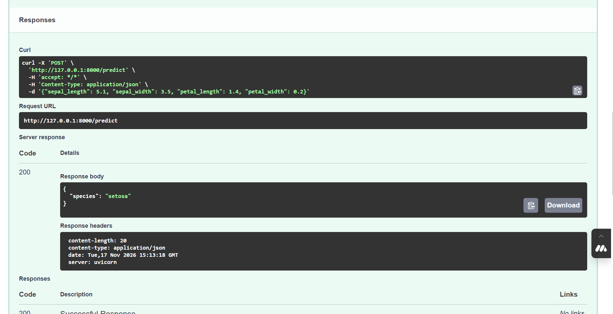
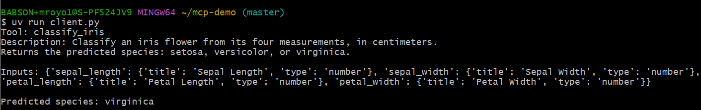
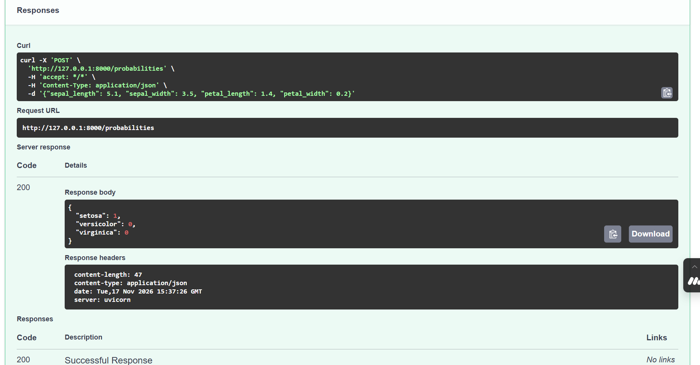
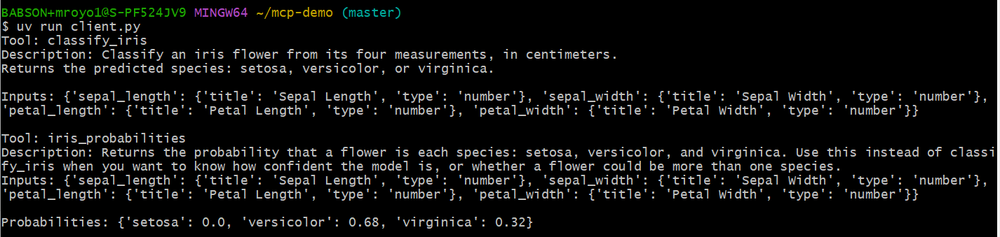

# MCP demo: iris classifier

Activity 22 (MCP and the Python SDK). A scikit-learn model served with FastAPI, then wrapped as an MCP tool.

## Screenshots

- Part 3, FastAPI `/predict` response: 
- Part 5, client listing one tool: 
- Part 6, FastAPI `/probabilities` response: 
- Part 6, client listing both tools with probabilities: 

## Answers

**Part 4, step 6: which function makes the prediction, and what does the MCP version add?**
`classify_iris` in `mcp_server.py` doesn't predict anything. It sends the four measurements to `/predict` in `api.py` over HTTP, and the model in `api.py` makes the prediction. The MCP version adds no new ability. It adds a tool description that an AI app can discover, plus a standard way for any MCP-capable app to call the tool.

**Part 5, step 8: where did the tool description and inputs come from?**
The description comes from the docstring in `mcp_server.py`, which is the text written in triple quotes under `def classify_iris`. The inputs come from the function's type hints, specifically the `float` values next to each parameter. The client uses this information to display the list of inputs.

**Part 5, step 8: who is each description written for?**
The `/docs` page is designed for people, such as developers who want to understand and use the API. The tool description, on the other hand, is written for the LLM. It uses that description to understand what the tool does and decide when to call it.

**Part 5, step 9: with the one-line docstring, would an LLM call the tool for "What kind of iris is this?"**
No, the LLM probably wouldn't call the tool because the one-line docstring only says `Does a calculation.` It doesn't mention irises or species classification, so the LLM wouldn't know that the tool could answer the question.

**Part 6, step 12: how sure is the model for 6.0, 2.7, 5.1, 1.6?**
Not very sure. The model gives versicolor 0.68, virginica 0.32 and setosa 0.0. It leans toward versicolor, but virginica is a real possibility. `classify_iris` would have returned only one species and hidden that uncertainty.

**Part 7, step 13: does our team's prototype need an MCP server?**
No. Our app (Aheadly) is a Streamlit app that calls the LLM itself and owns all of its code, so it can give the LLM tools directly through function calling, with no MCP server in between. It would need one if an AI app we don't control had to use Aheadly, for example if a business owner wanted to ask Claude or ChatGPT about their cash forecast, or if Aheadly became a service that customers' AI assistants call.
